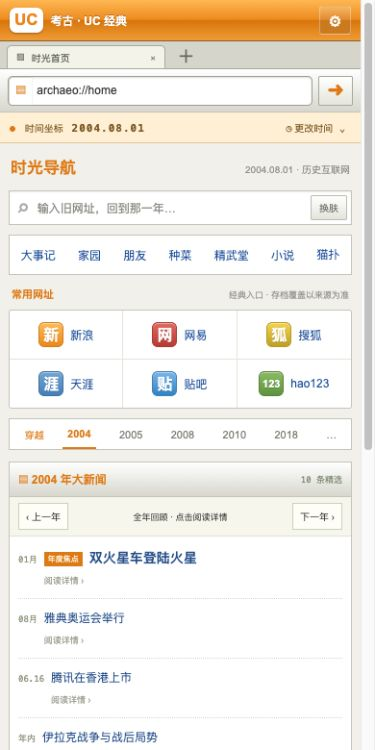
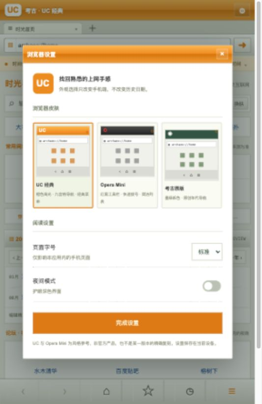
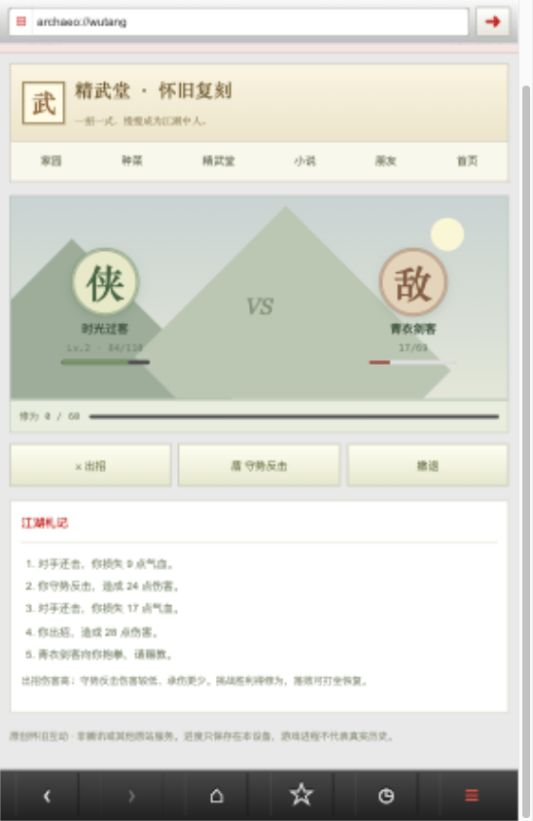
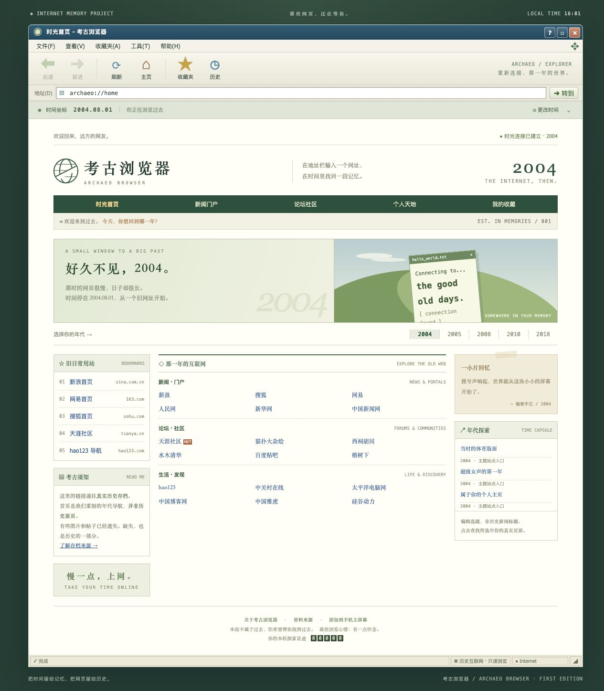
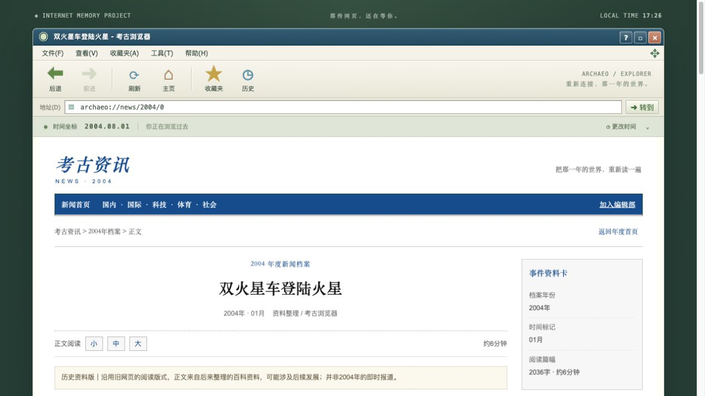
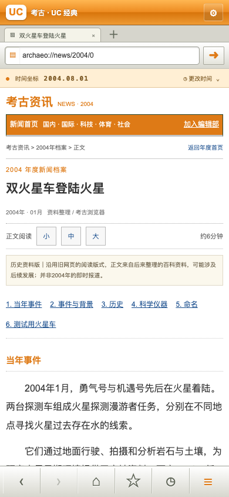

<div align="center">
  
  <h1>Olddays · 考古浏览器</h1>
  <p><strong>把记忆里的互联网，重新打开一次。</strong></p>
  <p>旧网址、老浏览器、家园、菜园和文字江湖。选择一个年份，慢慢逛回去。</p>
  <p>
    <a href="http://121.40.22.96/">在线体验</a> ·
    <a href="https://github.com/githubfordevelop/olddays/releases/latest">下载发布包</a> ·
    <a href="https://github.com/githubfordevelop/olddays/archive/refs/heads/main.zip">下载源码</a> ·
    <a href="https://github.com/githubfordevelop/olddays/issues">反馈与建议</a>
  </p>
  <p>
    <a href="https://github.com/githubfordevelop/olddays/actions/workflows/deploy.yml"></a>
    <a href="LICENSE"></a>
    
    
  </p>
</div>

## 那时，我们怎样上网？

从一个网址导航开始，点进论坛，看看别人的签名档。用小小的手机屏幕翻小说，给菜地浇一次水，再去精武堂练几招。网速很慢，能逛的世界却很大。

**考古浏览器**把这些体验装进一个可以直接打开的网页应用：电脑端是经典浏览器窗口，手机端可以换成 UC、Opera Mini 风格的外壳；地址栏连接真实网页存档，家园里的小游戏则让记忆重新有了可以动手玩的部分。

本项目处于 **v0.2 共建体验版**。欢迎下载、自部署、改造，也欢迎带着你记得的旧网址来补充它。

## 一起把老互联网做回来

这是一个开放共建的互联网记忆项目。我们需要史料编辑、旧网址线索、手机体验反馈、前端开发和原创小游戏作者。你不用会所有事情，从一个年份、一条勘误或一个小功能开始就够了。

**[我要加入 / 认领任务](https://github.com/githubfordevelop/olddays/issues/new?template=join.yml)** · [贡献指南](CONTRIBUTING.md) · [查看已有问题](https://github.com/githubfordevelop/olddays/issues)

## 看一眼过去

<div align="center">
  
  
  
</div>

<details>
<summary>查看桌面外观与站内新闻详情</summary>



桌面截图展示首版窗口与导航布局；手机截图展示已加入互动入口的新版。新闻阅读页已升级为老门户双栏布局，手机自动使用 WAP 排版。





</details>

## 可以做什么

| 入口                     | 已有体验                                                                                    |
| ------------------------ | ------------------------------------------------------------------------------------------- |
| **时光地址栏**           | 选择 1996—2025 的日期，输入 HTTP(S) 网址，核验后在浏览器外壳内打开历史网页，电脑与手机均保留地址栏和工具栏    |
| **年度大新闻**           | 每年 10 篇，共 300 篇带正文的历史资料页；正文约 800—2700 字符，分节阅读，含来源、版本与许可 |
| **UC / Opera Mini 风格** | 手机浏览器外壳、标签栏、快捷导航、底部菜单；三种皮肤可切换                                  |
| **阅读设置**             | 夜间模式、大字模式，自动记住当前设备上的选择                                                |
| **QQ 家园风格空间**      | 自定义昵称，查看游戏进度，从家园走进菜园、精武堂和书房                                      |
| **开心菜园**             | 六块菜地，播种、浇水、成熟、收获；铜钱循环和本机进度保存                                    |
| **精武堂风格小游戏**     | 练功、修为升级、挑战、出招、守势反击、撤退、打坐恢复                                        |
| **朋友网风格同学录**     | 把老朋友的昵称和一段回忆留在本机，不需要注册账号                                            |
| **掌上书房**             | 三回原创演示短篇《江湖来信》，章节翻页、自动续读，以及旧书站存档入口                        |
| **旧日互联网**           | 猫扑、天涯、贴吧、门户和个人站点的候选历史入口                                              |
| **时光收藏**             | 收藏“网址＋日期”；查看本次探索记录                                                          |

### 真实资料与怀旧互动

这两部分在界面中分别说明：

- **历史网页**来自 Internet Archive；是否有存档、图片是否完整，以来源实际保存情况为准。
- **大事记**是根据明确资料整理的全年精选，链接可能通向后来发表的回顾文章，不是当时的原始新闻流。
- **家园、同学录、种菜、精武堂与阅读演示**是原创怀旧互动，不连接原站账号或服务。游戏与场景可以在任意选定年份体验，不代表这些产品当时都已存在。
- **皮肤**参考旧式浏览器的视觉语言，不是 UC、Opera 或特定历史版本的精确复刻。

## 三分钟开始使用

### 直接体验

打开 **[在线体验](http://121.40.22.96/)**，无需安装或注册。手机端点击菜单或顶部设置按钮，可以切换皮肤和阅读方式。

### 下载到自己电脑

从 [Releases](https://github.com/githubfordevelop/olddays/releases/latest) 下载网页包，或直接下载源码 ZIP。解压后启动一个静态 HTTP 服务：

```sh
# 克隆源码
 git clone https://github.com/githubfordevelop/olddays.git
 cd olddays

# 启动网页，无需 npm install
 python3 -m http.server 4173 --directory dist
```

然后打开 <http://localhost:4173>。需要 Node.js 的部分仅用于开发检查，不是网页运行依赖。

> 部分浏览器会限制从 `file://` 页面发起请求，建议使用上面的 HTTP 服务。

### iPhone 添加到主屏幕

用 Safari 打开站点，选择“分享 → 添加到主屏幕”。支持触控导航、安全区和桌面图标。它是网页应用，尚无 App Store 原生客户端，也不缓存整片历史互联网供离线访问。

## 小游戏怎么玩

**菜园**：点击空地花 5 文播种，浇水两次，收获获得 15 文。没有强制真实等待，随时回来都能继续。

**精武堂**：练功积累修为并升级；挑战山门后，可以高伤出招或低伤守势反击。胜利获得修为和铜钱，落败后可以打坐恢复。它是原创小型回合制玩法，不是精武堂原版服务端。

**同学录与书房**：同学录只保存在本机；短篇阅读进度自动保存。更换浏览器、清除站点数据或换设备后，这些记录不会自动同步。

## 自己部署

这是静态应用，公开部署只需发布 `dist/`，可使用 Nginx、任意静态托管或 GitHub Pages。不要把整个源码仓库配置为 Web 文档根目录。

仓库提供两条工作流：

| 工作流             | 触发                    | 做什么                                                                                              |
| ------------------ | ----------------------- | --------------------------------------------------------------------------------------------------- |
| `Check and deploy` | PR、推送 main、手动运行 | 代码与资源检查；当前服务器在 CI 成功后拉取对应版本并切换 `current`；也提供可选 SSH + rsync 推送任务 |
| `Publish release`  | 推送 `v*` 标签          | 检查后生成网页包、源码包、SHA-256 清单，并创建 GitHub Release                                       |

服务器使用独立部署用户。当前拉取模式的维护私钥保留在维护设备；只有选择 SSH 推送模式时才把专用私钥存入 GitHub Secrets。主机公钥通过可信渠道核验，发布保留旧版本以便回滚。

完整配置见 **[部署指南](deploy/README.md)**；Nginx 示例见 [deploy/nginx.conf.example](deploy/nginx.conf.example)。当前服务器使用公开 CI 拉取模式：成功的 main 分支检查后，服务器约两分钟内拉取对应静态版本，无需在 GitHub 保存维护私钥；SSH 推送方式作为可选配置。

## 开发与检查

```sh
node scripts/check.mjs
bash -n scripts/deploy.sh
```

检查覆盖 JS 语法、静态资源引用、移动端 manifest、年度数据范围。另有6项应用行为测试、4项发布行为测试，以及浏览器交互验证：皮肤记忆、夜间模式、种菜循环、精武堂升级与战斗、同学录和小说翻页。

```text
olddays/
├── dist/                    # 可直接发布的网页
│   ├── app.js               # 浏览器、日期、收藏、设置
│   ├── annual-news.js       # 年度事件与出处
│   ├── mobile-scenes.js     # 家园、小游戏、同学录、书房
│   └── style.css            # 桌面与手机外观
├── docs/images/             # 项目截图
├── scripts/                 # 检查、发布与打包工具
├── deploy/                  # 服务器说明和 Nginx 示例
└── .github/workflows/       # CI/CD 与公开发布包
```

## 当前边界

- 不是完整互联网镜像，不保证任意站点、任意日期都有内容。
- 快照查询优先接受同年且不晚于目标日期的结果；无合适结果时提供来源日历，不自动伪造页面。
- 历史网页通过隔离的内嵌窗口展示，保留电脑与手机复古外壳。部分存档限制内嵌或缺失资源，可能无法显示；不会自动跳到外部页面。
- 存档内的后续链接、图片和动态功能由来源控制，可能跨日期或失效；当前未实现完整浏览链的时间锁定，内页地址也不会同步到外层地址栏。
- 大事记每年至少 10 条，仍然是编辑筛选与年表事实索引，不是完整新闻库。当前不做逐日新闻采集。站内详情包含事件资料和来源，部分核心事件有扩展导读，其余为简要资料卡。
- 游戏、收藏与同学录均为本机数据，没有多人互动、云存档、真实 QQ 登录或账号找回。
- 公开试玩目前使用 HTTP；需要 HTTPS 的功能和生产用途，应绑定域名并配置证书。

## 一起把记忆补回来

欢迎提交 Issue 或 Pull Request：旧网址与可访问的存档、年度事件的可靠出处、手机排版问题、无障碍改进、原创小游戏，以及你记忆里的浏览器细节。

提交历史资料时，请附网址、年份、来源，并说明是当时的记录还是后来的回顾。请勿上传私人账号数据、密钥、未获授权的小说全文或原站完整代码。详见 [贡献指南](CONTRIBUTING.md)。

## License / Credits

年度补充索引记录了来源与修订号，见 [数据出处](docs/data-sources.json)。来自维基百科的事实索引归属于 Wikipedia contributors；相关衍生索引按 [CC BY-SA 4.0](https://creativecommons.org/licenses/by-sa/4.0/) 标注，筛选和压缩不代表原站排名。该数据许可独立于代码许可。

原创代码与原创演示内容采用 **[MIT License](LICENSE)**，可以下载、修改和自行部署。历史网页、外部资料、商标及其权利不因本仓库的许可而改变；本项目与 UC、Opera、腾讯、朋友网、精武堂等原产品无隶属或官方合作关系。

主要资料入口：[Internet Archive](https://web.archive.org/)、[中国政府网大事记](https://www.gov.cn/xinwen/2019-09/27/content_5434223.htm?allContent=)、[NASA](https://science.nasa.gov/)、[国家航天局](https://www.cnsa.gov.cn/)。具体事件出处保存在 `dist/annual-news.js` 中。

---

**English:** Olddays is a lightweight, self-hostable web nostalgia project with retro desktop/mobile browser shells, real web-archive links, curated year highlights, and original local-only mini-games. No runtime packages, account registration, or original service credentials are required. Historical coverage is partial; the project is independent of the brands it references.

## 新闻资料的编辑方式

`data/news-articles.json` 保存已节选的正文、段落标题、固定修订版本和署名。修改后运行 `node scripts/build-news.mjs` 生成浏览器数据与来源清单，再运行 `node scripts/check.mjs`。部署时直接分发静态正文，用户无需等待第三方百科 API 才能阅读。

复古新闻页提供正文目录、字号切换、上一篇/下一篇、同年新闻和共建入口。它是有署名的历史资料版，文字可能包含后续发展，不冒充当年报刊的原始报道。[正文许可说明](docs/NEWS-LICENSE.md)与 MIT 代码许可分别适用。
